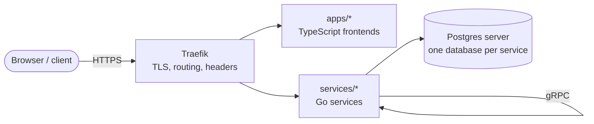

# Architecture

> Status: **accepted**. This repository is a reusable base for new products (P-0016). It fixes the generic,
> technical architecture; product choices are open questions (Q6–Q11 in
> [`docs/decisions/registry.yaml`](docs/decisions/registry.yaml)) decided when their trigger is reached
> ([`docs/standards/new-product.md`](docs/standards/new-product.md)). If this file disagrees with an accepted
> ADR, the ADR wins and this file must be fixed.

## 1. System context



Traefik is the only exposed container. Which apps and services exist depends on the product (Q6); the
[service catalog](docs/catalog/services.yaml) is the source of truth.

## 2. Service boundaries

| Rule | Source |
|---|---|
| **One service per business domain.** A new domain means a new service with its own database, generated from `templates/go-service`. A new entity of an existing domain stays in that service. | D-0014 |
| **Go is the default backend language.** Another language only when its core dependency requires it, recorded as a registry exception. | D-0004 |
| **Frontends are TypeScript** containers; framework and rendering mode are decided per product (Q11). | D-0024 |
| Deployables never import each other; `packages/` holds build-time libraries only. | D-0002 |

## 3. Communication model

| Kind | Mechanism | Status |
|---|---|---|
| Service → service, synchronous | gRPC (connect-go) on the private network, contracts in `contracts/proto/<domain>/v<N>/` | decided (D-0022) |
| Browser / third party → backend | REST transcoding, Connect JSON client or other | **deferred, Q8** (first public API) |
| Service → service, asynchronous | none yet; options: Redis pub/sub (loses messages), Redis Streams, a broker | **deferred, Q7** (first event) |
| Identity propagation | a token from the identity component, verified locally by each service | **deferred, Q10** (first signed-in feature) |

Breaking contract changes need a new version package (`v<N+1>`). Messaging, when added, sits behind
`Publisher`/`Subscriber` ports so the transport can change inside one adapter.

## 4. Data ownership (D-0008)

- **One Postgres server, one database per service** in every environment. Each database has `<svc>_owner`
  (DDL, migrations only) and `<svc>_app` (DML, runtime) roles.
- No service reads another service's database. No cross-database foreign keys; reference other data by opaque IDs.
- Migrations: versioned SQL in the owning service, applied by the explicit `migrate` command of **the same
  image**, before rollout, never at app startup. Changes are expand/contract across releases.
- Each service gets its own connection URL, so a database can move to another server through config alone.
- **Backups:** decided with hosting (Q9). Mandatory before real user data reaches prod.

## 5. Repository topology

```text
.
├── AGENTS.md  ARCHITECTURE.md  CONTRIBUTING.md  Makefile
├── apps/                     # frontends (deployable), once Q11 is decided
├── services/                 # backends (deployable), one per domain, from templates/go-service
├── packages/                 # build-time libraries only; never deployable
├── contracts/proto/          # source of truth for service APIs and events, versioned
├── infra/
│   ├── compose/              # base + local + deploy overlays (same images everywhere)
│   ├── traefik/              # static config
│   ├── postgres/             # init: databases + roles per service
│   ├── env/{local,dev,prod}/ # NON-secret config per environment
│   ├── deploy/               # deploy script (SSH + Compose)
│   └── k8s/                  # planned: only after an ADR approves Kubernetes
├── templates/                # generators: go-service (frontend/auth templates once decided)
├── e2e/                      # planned: end-to-end suite, with the first user flow
├── openspec/                 # specs, changes, project context
├── docs/{adr,decisions,standards,catalog,agents}/
├── tools/harness/            # Go CLI: repository validation rules
└── .github/workflows/        # pr.yml, main.yml, release.yml + reusable workflows
```

## 6. Delivery and environments (D-0023)

| Env | Runs on | Images | Trigger | Secrets |
|---|---|---|---|---|
| local | developer machine, `make up` | built locally | — | `infra/env/local/*.env` (dev-only values) |
| dev | a Linux host with Docker Compose, over SSH | GHCR, by digest | merge to `main` | GitHub Environment `dev` → `0600` secret files |
| prod | a Linux host with Docker Compose, over SSH | **same digests** as dev | tag `vX.Y.Z` + owner approval | GitHub Environment `prod` → `0600` secret files |

```text
change/<name> ──PR──► pr.yml      make check + checks of changed deployables
merge to main ──────► main.yml    build every image once (tag = git SHA) → GHCR → deploy dev
tag vX.Y.Z ─────────► release.yml same digests → owner approval → deploy prod   (rollback: re-run previous tag)
```

- Deploy: upload Compose files, a non-secret `.env` (digests, domain) and `0600` secret files → `docker compose pull` → `migrate` → `up -d --wait` → smoke test.
- Deploy jobs skip themselves until the environment's host variables exist, so CI works before any server does.
- How hosts are created (OpenTofu, cloud provider), DNS and TLS domain are **deferred (Q9, Q3)**.

## 7. Security model (baseline: OWASP ASVS L1, D-0012)

- **Authentication:** deferred (Q10). Whatever is chosen: no custom crypto, short-lived tokens, verified locally.
- **Authorization:** deny by default; coarse roles from the token, resource ownership checks in each
  service's application layer.
- **CORS:** backends allow only the product's frontend origins, configured per environment.
- **Network:**
  - Only Traefik publishes ports (80/443).
  - Traefik reaches Docker through a **read-only socket proxy** on an isolated network; the socket is never mounted into Traefik.
  - `exposedByDefault=false`. Data stores and ops ports are never routed.
- **Containers:** non-root, `cap_drop: ALL`, `no-new-privileges`, read-only root filesystem where possible,
  base images pinned by digest.
- **Secrets:** never in git. Runtime injection from GitHub Environments.
- **Compliance:** GDPR applicability decided with the launch country (Q4); the catalog keeps a personal-data inventory per deployable.

## 8. Observability model (D-0011)

- **Logs:** JSON to stdout. Fields: `ts level msg service version env request_id trace_id`. Never log
  secrets, tokens, cookies or personal data.
- **Correlation:** read or generate `X-Request-ID`; propagate it and `traceparent` on HTTP, gRPC and event metadata.
- **Traces and metrics:** OpenTelemetry SDK, enabled only when `OTEL_EXPORTER_OTLP_ENDPOINT` is set.
  A local telemetry stack is not part of Compose yet (P-0002); add it when traces are needed.

## 9. Service runtime contract (every deployable)

| Item | Standard |
|---|---|
| App port | `8080` |
| Ops port | `8081`, never routed by Traefik: `GET /livez` (process alive), `GET /readyz` (dependencies OK) |
| Routing | Compose labels on the service. `traefik.enable=true` only for public services. Labels never reference 8081 |
| Config | env vars only. Validated at startup; fail fast with a clear message |
| Secrets | env vars injected at runtime; `<NAME>_FILE` variant supported |
| Shutdown | SIGTERM: stop readiness → drain → exit within 20 s |
| State | stateless; volumes only for data stores |
| Image | multi-stage, pinned base digest, non-root UID 65532, `HEALTHCHECK` on the ops port |
| Frontend config | runtime config rendered from env at container start, so one image works in every environment |

`templates/go-service` implements this contract; `tools/harness` checks the parts that can be checked.

## 10. Testing model (D-0017)

| Layer | Tooling | Gate |
|---|---|---|
| Unit | `go test -race` (TS: the frontend stack's runner) | **≥ 80 % coverage** per deployable; generated code excluded |
| Integration | Testcontainers (Postgres, other stores) | every PR touching the service |
| Contract | `buf breaking`; generated clients compile | blocks merge |
| Migration | apply to an empty DB and to a DB at the previous version | blocks merge |
| E2E | Playwright against the Compose stack (emails read from Mailpit) | every user-facing flow when possible |

## 11. Key trade-offs

| Decision | Gain | Cost |
|---|---|---|
| Compose on one host per env | simple, cheap | single point of failure; seconds of downtime per deploy |
| One Postgres server, DB per service | cheap; clear ownership | shared failure domain and resource contention |
| Service per domain | clear ownership; independent deploys | more services to operate; no cross-domain transactions |
| Traefik via labels + socket proxy | routing next to the service; maps to Kubernetes IngressRoute | Docker API access (mitigated by a read-only proxy) |
| Product choices deferred | no rework when the product is chosen | the first product sessions must answer Q6–Q11 |
| Build every image on each merge | simple, always a full release set | slower CI as deployables grow |

## 12. Kubernetes migration path

Already in place: same images, env-only config, probes on `:8081`, stateless services, graceful SIGTERM,
migrations as a separate command, DNS service names only.

| Compose today | Kubernetes later |
|---|---|
| service + `deploy.resources` | Deployment + requests/limits |
| healthcheck on `:8081` | liveness/readiness/startup probes |
| `docker compose run <svc> migrate` | Job / Helm pre-upgrade hook |
| Traefik + Docker labels | Traefik IngressRoute (or Gateway API) + cert-manager |
| secret files from GitHub Environments | ConfigMap + Secret via External Secrets |
| networks `edge` / `data` / `socket` | NetworkPolicies |
| Postgres container | managed service (URL change only) |

## 13. Deferred components and trigger conditions (P-0002)

| Component | Introduce when |
|---|---|
| Kubernetes | need > 1 node for availability, zero-downtime deploys, autoscaling, or > ~8 deployables |
| API gateway | third-party API consumers (keys/quotas), or shared policies across > 3 public backends |
| Messaging (Q7) | the first event between services; durable (Streams/broker) if losing it is unacceptable |
| Service mesh / mTLS | compliance requires encryption between services, or > 10 services with traffic policies |
| Cache | measured latency or DB load problem |
| Secrets manager | > 1 host per env, mandatory rotation, or audit requirement |
| Infrastructure as code (Q9) | the first deploy to a real dev host |
| Staging environment | the owner asks for it, or prod releases need a production-like rehearsal |
| Postgres backups | **before any real user data in prod** |
