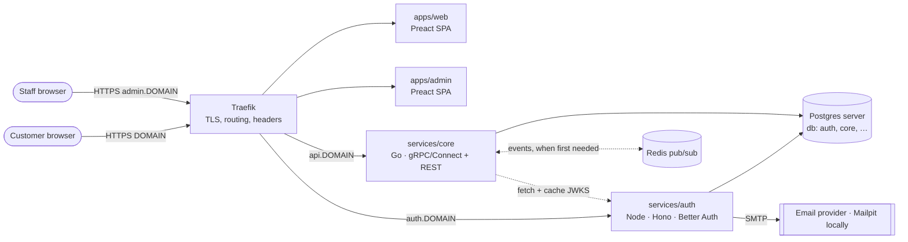

# Architecture

> Status: **accepted** (2026-10-15). Scope right now is the *way of working*
> plus a first basic architecture; no product features yet. Decisions live in
> [`docs/decisions/registry.yaml`](docs/decisions/registry.yaml) and [`docs/adr/`](docs/adr/).
> This file is the narrative view; if it disagrees with an accepted ADR, the ADR wins and this file must be fixed.

## 1. System context

B2C product. Public customers use the customer web app; staff (admin, support) use a
separate admin app. All traffic enters through Traefik.



## 2. Service boundaries

| Service | Path | Tech | Owns | Exposed |
|---|---|---|---|---|
| Customer web | `apps/web` | Preact + Vite SPA, TS | UI only | `DOMAIN` |
| Admin web | `apps/admin` | Preact + Vite SPA, TS | UI only | `admin.DOMAIN` |
| Identity | `services/auth` | Node 24 + Hono + Better Auth, TS | users, sessions, verification tokens, roles, signing keys | `auth.DOMAIN` |
| Core | `services/core` | Go, hexagonal-lite | the first business domain (renamed once the domain is known) | `api.DOMAIN` |

Rules (ADR-0004, ADR-0014):
- **Go is the default backend language.** A service may use another language only when its
  core dependency requires it. The reason is recorded in the service catalog and the registry.
  `auth` is Node because Better Auth is a TypeScript-only library.
- **One service per business domain.** A new domain (catalog, orders, billing…) means a new service with its own database,
  generated from the template. A new entity that belongs to an existing domain stays in that domain's service.
- `core` is not a catch-all. It holds the first domain only.

## 3. Communication model

| Kind | Mechanism | Contract |
|---|---|---|
| Browser → backend | REST/JSON over HTTPS, transcoded by Vanguard from `google.api.http` annotations | `contracts/proto/<domain>/v<N>/` → generated `contracts/openapi/` |
| Service → service, synchronous | gRPC (connect-go server, gRPC protocol) over the private network | same protobuf |
| Service → service, asynchronous | Redis pub/sub channels `<domain>.<event>.v<N>` | protobuf event messages in `contracts/proto/<domain>/events/v<N>/` |

- **Identity propagation:**
  - The browser gets a short-lived JWT from `auth` (`/api/auth/token`) and sends `Authorization: Bearer` to APIs.
  - Go services verify it locally against cached JWKS.
  - Service-to-service gRPC calls forward the caller's JWT. Service identities come later, with the first internal call.
- **Async limits (ADR-0015):** Redis pub/sub is **at-most-once**. A message is lost if a subscriber is down,
  restarting or slow. Allowed only for events where loss is acceptable (notifications, cache
  invalidation, UI refresh). Consumers are idempotent. Messaging sits behind a `Publisher`/`Subscriber`
  port, so upgrading to Redis Streams (same server) or RabbitMQ is a change local to the adapter.
- `buf lint` + `buf breaking` run against `main` in CI for both APIs and events.

## 4. Data ownership

- **One Postgres server, one database per service** (`auth`, `core`, …) in every environment.
  Each database has `<svc>_owner` (DDL, migrations only) and `<svc>_app` (DML, runtime) roles.
- No service reads another service's database. No cross-database foreign keys. Other services' data is referenced by opaque IDs.
- Migrations: versioned SQL in the owning service, applied by the explicit `migrate` command of
  **the same image**, before rollout, never at app startup. Changes are expand/contract across releases.
- Every service gets its own connection URL, so a database can later move to another server or a managed service through config alone.
- **Backups:** deferred by owner decision. Must be in place before real user data reaches prod (see §13).

## 5. Repository topology

```text
.
├── AGENTS.md  ARCHITECTURE.md  CONTRIBUTING.md  Makefile
├── apps/                     # frontends (deployable): web, admin
├── services/                 # backends (deployable): auth (Node), core (Go), one per domain
├── packages/                 # build-time libraries only; never deployable
│   ├── go/platform/          # health, config, logging, otel, shutdown, messaging port
│   └── ts/                   # ui kit, generated API client, shared configs
├── contracts/
│   ├── proto/                # source of truth: APIs + events, versioned
│   └── openapi/              # generated from proto, committed, never hand-edited
├── infra/
│   ├── compose/              # base + local + deploy overlays (same images everywhere)
│   ├── traefik/              # static config, shared middlewares
│   ├── postgres/             # init: databases + roles per service
│   ├── env/{local,dev,prod}/ # NON-secret config per environment
│   ├── tofu/                 # OpenTofu: provider-neutral modules + AWS default implementation
│   │   ├── modules/<capability>/        # interface module (provider-agnostic inputs/outputs)
│   │   ├── modules/<capability>/aws/    # AWS implementation (default)
│   │   └── envs/{dev,prod}/             # composition per environment
│   └── k8s/                  # reserved; empty until an ADR approves Kubernetes
├── e2e/                      # Playwright end-to-end suite against the Compose stack
├── openspec/                 # specs, changes, project context
├── docs/{adr,decisions,standards,catalog}/
├── templates/                # generators: go-service, node-service, ts-spa
├── tools/harness/            # Go CLI: repository validation rules
└── .github/workflows/        # reusable + path-filtered workflows
```

Changes from the suggested layout:
- **`deploy/` is folded into `infra/`.** One home for environment and deployment material.
- **`shared/` → `packages/`, build-time libraries only.** No runtime coupling between deployables.
- **`e2e/` sits at the top level.** End-to-end tests cover several deployables, so they don't belong to any one of them.

## 6. Deployment topology

| Env | Provisioned by | Runs on | Images | Secrets |
|---|---|---|---|---|
| local | — | developer machine, `make up` | built locally | `infra/env/local/*.env` (dev-only values) |
| dev | OpenTofu `envs/dev` (AWS default) | 1 VM, Docker Compose | GHCR, by digest | GitHub Environment `dev` → root-only env file |
| prod | OpenTofu `envs/prod` | 1 VM, Docker Compose | **same digests** as dev | GitHub Environment `prod` → root-only env file |

- OpenTofu provisions:
  - network
  - firewall (80/443 public; SSH only from an allowlist)
  - VM with Docker via cloud-init
  - persistent volume for Postgres/Redis data
  - static IP
  - DNS (later, once a domain exists)
- Postgres and Redis run as containers on the VM. That keeps the stack cloud-neutral; a move to a managed service is a config change.
- Deploy (GitHub Actions over SSH): write the release manifest (digests) and env file →
  `docker compose pull` → `migrate` changed services → `up -d --wait` → smoke test.
  Prod = manual promotion of a manifest already deployed to dev, with required reviewers.
- The registry owner is taken from `github.repository_owner`, so nothing is hard-coded before the repo exists.

## 7. Security model (baseline: OWASP ASVS L1, ADR-0012)

- **Authentication:** email magic link only, for everyone (no passwords, no passkeys yet).
  Staff accounts (`support`, `admin`) are invite-only and cannot self-register.
  Risk: anyone who controls a staff member's email inbox controls their account. Revisit before real staff use prod.
- **Authorization:**
  - Coarse RBAC from the JWT `role` claim (`customer`, `support`, `admin`).
  - Resource ownership checks in each service's application layer.
- **Tokens:**
  - JWT EdDSA, TTL ≤ 15 min, `iss`/`aud` checked, keys rotated by Better Auth.
  - Session cookie is `HttpOnly; Secure; SameSite=Lax`, host-only on `auth.DOMAIN`.
- **CORS:** backends allow only the frontend origins, configured per environment.
- **Network:**
  - Only Traefik publishes ports (80/443).
  - Traefik reaches Docker through a **read-only socket proxy** (container listing only) on an isolated network. The socket is never mounted into Traefik.
  - `exposedByDefault=false`.
  - Postgres, Redis and ops ports are never routed.
- **Containers:** non-root, `cap_drop: ALL`, `no-new-privileges`, read-only root filesystem where
  possible, base images pinned by digest, SBOM per image.
- **Secrets:** never in git (gitleaks). Runtime injection from GitHub Environments. OpenTofu state is encrypted.
- **Compliance:** launch country unknown, so GDPR applicability is **undetermined**. A minimal
  personal-data inventory is kept per service so the call is cheap to make later.

## 8. Observability model

- **Logs:** JSON to stdout (Go `log/slog`, Node `pino`). Fields: `ts level msg service version env request_id trace_id`.
  Never log tokens, cookies, emails or magic-link URLs.
- **Correlation:**
  - Traefik tracing (OTel) emits W3C `traceparent` when enabled.
  - Each service generates `request_id` if `X-Request-ID` is absent and propagates both values on HTTP, gRPC and event metadata.
- **Traces and metrics:** OpenTelemetry SDK, enabled only when `OTEL_EXPORTER_OTLP_ENDPOINT` is set.
- **Local stack:** Compose profile `obs` runs `grafana/otel-lgtm`. No hosted stack in prod yet.

## 9. Service runtime contract (every deployable)

| Item | Standard |
|---|---|
| App port | `8080` (REST/gRPC for Go services, HTTP for others) |
| Ops port | `8081`, never routed by Traefik: `GET /livez` (process alive), `GET /readyz` (deps OK) |
| Routing | Compose labels on the service. `traefik.enable=true` only for public services. Labels never reference 8081 |
| Config | env vars only. Validated at startup; fail fast with a clear message |
| Secrets | env vars injected at runtime; `<NAME>_FILE` variant supported |
| Shutdown | SIGTERM: stop readiness → drain → exit within 20 s |
| State | stateless; volumes only for Postgres/Redis |
| Image | multi-stage, pinned base digest, non-root UID 65532, `HEALTHCHECK` on ops port |
| Frontend config | `/config.js` rendered from env at container start, so one image works in every environment |

## 10. Testing model (ADR-0017)

| Layer | Go | TS (Node + Preact) | Gate |
|---|---|---|---|
| Unit | `go test`, every package has tests | Vitest (+ Testing Library for Preact), every module has tests | **≥ 80 % coverage** per deployable; generated code excluded |
| Integration | Testcontainers (Postgres, Redis) | Testcontainers | runs on every PR touching the service |
| Contract | `buf breaking`, generated clients compile | same | blocks merge |
| Migration | apply to an empty DB and to a DB at the previous version | same | blocks merge |
| E2E | Playwright against the Compose stack; magic link read from the Mailpit API | | every user-facing flow when possible; exceptions recorded in the OpenSpec change |

## 11. Key trade-offs

| Decision | Gain | Cost |
|---|---|---|
| Compose on 1 VM per env | simple, cheap | single point of failure; seconds of downtime per deploy |
| Better Auth (Node) beside Go | proven magic-link flow; no custom crypto | second backend toolchain |
| JWT + JWKS | `auth` not on the API hot path | revocation delayed up to the token TTL |
| Proto + Vanguard REST | one contract for REST, gRPC and events; breaking-change checks | more codegen tooling |
| One Postgres server, DB per service | cheap; clear ownership | shared failure domain and resource contention |
| Redis pub/sub | trivial to run; very low latency | messages lost when a consumer is offline; no retry or DLQ |
| Service per domain | clear ownership; independent deploys | more services to operate; no cross-domain transactions |
| Traefik via labels + socket proxy | routing lives next to the service; maps to Kubernetes IngressRoute | needs Docker API access (mitigated by a read-only proxy) |
| OpenTofu, provider-neutral modules | can switch cloud without rewriting env composition | an interface layer per capability |
| No backups yet | no setup cost | **any volume loss is permanent data loss** |

## 12. Kubernetes migration path

What is in place now that makes the move mechanical:
- same images
- env-only config
- probes on `:8081`
- stateless services
- graceful SIGTERM
- migrations as a separate command
- DNS service names only

| Compose today | Kubernetes later |
|---|---|
| service + `deploy.resources` | Deployment + requests/limits |
| healthcheck on `:8081` | liveness/readiness/startup probes |
| `docker compose run <svc> migrate` | Job / Helm pre-upgrade hook |
| Traefik + Docker labels | Traefik IngressRoute (or Gateway API) + cert-manager |
| env file from GitHub Environments | ConfigMap + Secret via External Secrets |
| networks `edge` / `data` / `socket` | NetworkPolicies |
| Postgres / Redis containers | managed services (URL change only) |
| OpenTofu VM module | OpenTofu cluster module (EKS default) |

## 13. Deferred components and trigger conditions

| Component | Introduce when |
|---|---|
| Kubernetes | need > 1 node for availability, zero-downtime deploys, autoscaling, or > ~8 deployables |
| API gateway | third-party API consumers (keys/quotas), or shared policies across > 3 public backends |
| Durable messaging (Redis Streams → RabbitMQ) | the first event whose loss is unacceptable (payments, orders, anything a user would notice missing) |
| Service mesh / mTLS | compliance requires encryption between services, or > 10 services with traffic policies |
| Cache | measured latency or DB load problem |
| Secrets manager (SOPS / Vault / AWS SM) | > 1 VM per env, mandatory rotation, or audit requirement |
| Postgres backups | **before any real user data in prod** |
| Separate / managed Postgres | resource contention, or availability needs beyond one VM |
| Staff 2FA (TOTP or passkeys) | before staff use prod with real customer data |

## 14. Assumptions and open questions

Assumptions (reversible; `source: default` in the registry):
- A1: project slug `har`; domains are config (`DOMAIN`).
- A2: seconds of downtime per deploy is acceptable initially.
- A3: staff accounts are invite-only.
- A4: initial deployables are `apps/web`, `apps/admin`, `services/auth`, `services/core`.
- A5: `core` is renamed when the first business domain is named.

Open questions (none block Phase 3):
- Q3: email provider and domain, both unknown. Local dev uses Mailpit and `*.localhost`.
- Q4: launch country unknown → GDPR applicability undetermined.
