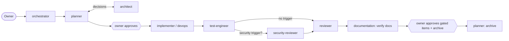

# Agent roles

Nine roles with no overlap (P-0008). Each role file is the **canonical, tool-neutral contract**.
Tool adapters (e.g. `.opencode/agents/<role>.md`) only add permissions and point here (R-AGENT-002).

| Role | One-line purpose | Writes to |
|---|---|---|
| [orchestrator](orchestrator.md) | Sequences the work, enforces evidence and owner gates. **Entry point** | nothing (delegates only) |
| [architect](architect.md) | Owns decisions, boundaries and decision changes | `docs/adr`, `docs/decisions`, `ARCHITECTURE.md`, `docs/standards`, `AGENTS.md` files |
| [planner](planner.md) | Turns requests into approved OpenSpec changes; archives them | `openspec/changes/**`, `openspec/specs/**` (archive), `docs/catalog` (planned entries) |
| [implementer](implementer.md) | Implements tasks with unit and integration tests, and documents them | code, migrations, contracts, service docs |
| [test-engineer](test-engineer.md) | Independent verification: coverage gaps, contract, migration and e2e tests | tests, `e2e/` |
| [security-reviewer](security-reviewer.md) | ASVS L1 review of security-sensitive changes only | reports only |
| [reviewer](reviewer.md) | Correctness and design fit; last code-quality gate | reports only |
| [documentation](documentation.md) | Verifies each role documented its work; fixes gaps | Markdown docs, `docs/catalog` (fixes only) |
| [devops](devops.md) | Compose, Traefik, OpenTofu, CI/CD, deploys | `infra/`, `.github/`, `Makefile` |

## Separation rules
- **Orchestrator** never edits files, so it cannot do work it should delegate.
- **Security-reviewer** runs only when a [security trigger](../standards/security.md#security-review-triggers) matches.
  The reviewer rejects a triggered change that skipped it.
- **Every role documents its own work** in the same step, using the documentation map below. The documentation role
  verifies this against the diff and fixes descriptive gaps. It is a check, not a substitute.

## Documentation map
What each kind of change must update. The author does it, and documentation verifies it.

| When you change… | Update | Usual author |
|---|---|---|
| a decision, preference or convention | `docs/decisions/registry.yaml` (+ `changelog`), ADR + ADR index, affected `docs/standards`, `AGENTS.md` files | architect |
| a deployable's behavior, config or env vars | its `README.md` (purpose, env vars, commands), its `AGENTS.md` if rules change | implementer |
| deployables, ownership, data or dependencies | `docs/catalog/services.yaml` (+ dependency diagram), `ARCHITECTURE.md` §2 | planner (planned), implementer (active) |
| a contract | the proto comments; `contracts/openapi` regenerated | implementer |
| personal data fields | the catalog's `personal_data` | implementer |
| infra, Compose, CI, deploys | `infra/**/README.md`, the deploy/rollback notes in the change, `ARCHITECTURE.md` §6 if topology changes | devops |
| tests or the testing approach | the coverage table in `docs/standards/testing.md`; the e2e-not-possible reason in `tasks.md` | test-engineer |
| security controls or risks | status column / accepted risks in `docs/standards/security.md` (through architect if a rule changes) | security-reviewer reports, architect edits |
| validation rules | `docs/standards/validation.md` | implementer |
| developer commands or prerequisites | root `README.md` / `CONTRIBUTING.md`, `make help` text | whoever changes them |

## Flow (run by the orchestrator)

Findings at any step go back through the orchestrator to the owning role. After two failed rounds with the same findings, it escalates to the owner.

## Rules for every role
- Follow [`AGENTS.md`](../../AGENTS.md): session start, precedence, memory protocol, conflict format.
- Document your own work in the same step (documentation map above).
- Run `make check` before every handoff, and include the actual result in the handoff.
- Handoff message:
  `HANDOFF <from> → <to> | change: <name> | done: … | docs: <files updated, or "none needed: reason"> | evidence: <commands + results> | open: …`.
- **Owner approval always required for:**
  - accepting or superseding decisions
  - new infrastructure components or external services
  - security-sensitive changes
  - production deploys
  - `tofu apply`
  - destructive migrations
  - lowering a quality gate
  - archiving a change
